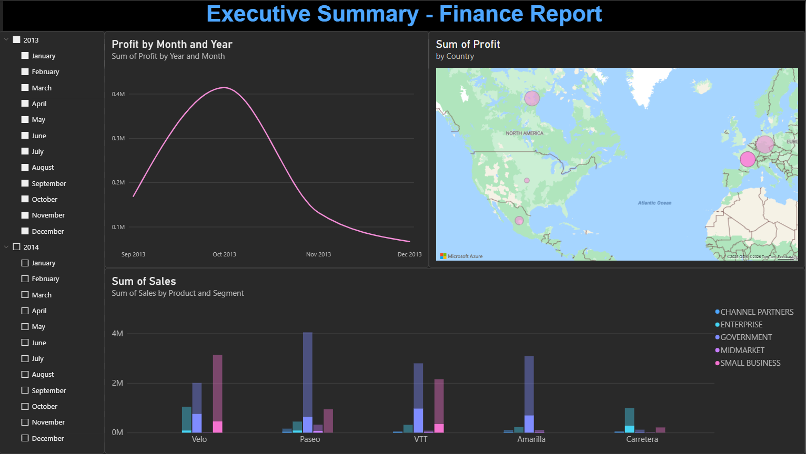

# First Dashboard

## Overview

This dashboard was created using Microsoft Power BI as part of my Power BI learning journey.

The report provides an executive summary of financial performance through interactive visualisations, allowing users to analyse profit trends, sales performance, and geographical profitability.

## Dashboard Features

- Interactive Year and Month slicer
- Profit analysis by month and year
- Geographic profit visualisation
- Sales analysis by product and segment
- Executive summary dashboard layout
- Dark theme report design

## Skills Demonstrated

- Microsoft Power BI
- Data Visualisation
- Dashboard Design
- Report Formatting
- Interactive Filtering
- Business Intelligence Reporting
- Data Analysis

## Files Included

| File | Description |
|------|-------------|
| 1 - First Dashboard.pbix | Power BI project file |
| 1 - First Dashboard.png | Dashboard screenshot |
| README.md | Project documentation |

## Key Learning Outcomes

- Creating and configuring Power BI visualisations
- Designing interactive reports
- Using slicers to filter report data
- Applying consistent report formatting
- Building executive-style dashboards
- Presenting business insights using data

## Tools Used

- Microsoft Power BI Desktop
- Microsoft Learn

## Author

Kevin Santos